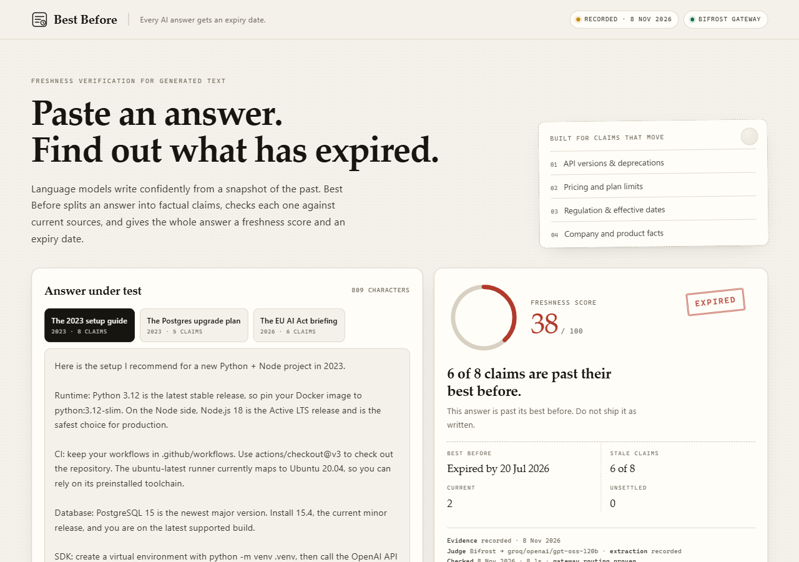

# Best Before

**Every AI answer gets an expiry date.**

Language models answer from a snapshot of the past, but they answer in the present tense. A guide written in 2023 says "Python 3.12 is the latest release" with total confidence, and nothing in the answer tells you that three major versions have shipped since.

Best Before takes an AI-generated answer, splits it into individual factual claims, re-verifies each claim against current web sources, and gives the whole answer a freshness score and an expiry date. Click any claim to see the exact passages that supported or contradicted it.

The point is not to catch a model lying. The point is to show you *which sentences have rotted*, and to do it with evidence you can inspect.



---

## What it looks like

Paste an answer, or pick one of three demo answers built from real, cited documentation:

| Sample | Written | Verdict | Why |
| --- | --- | --- | --- |
| The 2023 setup guide | Jun 2023 | **EXPIRED** · 38/100 | Python, Node, checkout, runner image, Postgres and the OpenAI SDK have all moved. Six of eight claims are stale. |
| The Postgres upgrade plan | Nov 2023 | **EXPIRED** · 42/100 | "15 is the latest major" and "12 is supported until next year" both stopped being true. |
| The EU AI Act briefing | Feb 2026 | **NEEDS CORRECTION** · 67/100 | Four dates are right; the scope and compliance-timeline sentences are wrong. |

Each claim carries three readings and a source list:

```
Python 3.12 is the latest stable release.        38/100  STALE
  ⚠  What is current: Python 3.15.2 is the current release (25 Oct 2026).
  ✓  python.org/downloads/              authority 0.96   25 Oct 2026
  ✓  python.org/downloads/release/...   authority 0.96   25 Oct 2026
```

---

## How the score is built

One claim:

```
freshness = 0.60 * agreement + 0.25 * recency + 0.15 * authority
```

- **Agreement** — what the relevant sources say about the claim's *specific value*. A contradiction in primary documentation outweighs any number of blog posts that repeat the claim.
- **Recency** — publication age, decayed on a half-life per claim type: pricing 120 days, versions 240, regulation 365, company 180.
- **Authority** — a domain tier from primary documentation (0.95–0.98) through vendor releases (0.86–0.90), curated trackers (0.82), press (0.66–0.78) and community (0.22–0.55).

Thresholds: `>= 0.72` current, `0.45–0.72` recheck, `< 0.45` stale. A stale claim in a high-impact category (pricing, version, regulation) can expire the whole answer even when most claims are fine — which is the correct behaviour when the answer contains a `pip install` line that no longer runs.

The weights are opinionated on purpose: *whether a source agrees* matters more than *whether it is new*, because a fresh blog repeating an old version number is still wrong.

---

## Architecture

```
 pasted answer
      │
      ▼
 ┌──────────────┐   model extraction, with a real regex fallback
 │    claims    │   that is labelled "heuristic" in the report
 └──────┬───────┘
        │  up to 8 claims, each with a search query
        ▼
 ┌──────────────┐   Tavily /search (live) or recorded captures
 │   evidence   │   ── evidence mode: tavily | recorded | none
 └──────┬───────┘
        │
        ▼
 ┌──────────────┐   Bifrost /v1/chat/completions, with a fallback
 │    judge     │   model in the request body
 └──────┬───────┘   ── judge mode: bifrost | direct | recorded | heuristic
        │
        ▼
 ┌──────────────┐
 │ freshness    │   0.60 agreement + 0.25 recency + 0.15 authority
 │ + expiry     │   per claim, then weighted across the answer
 └──────────────┘
```

Both partner services are load-bearing, in both modes:

- **Tavily** is the only source of live evidence. Each claim gets its own targeted query, and Tavily's `content` snippet plus `published_date` are exactly the two fields the scorer needs. No Tavily key means no live evidence — the report says so rather than inventing sources.
- **Bifrost** is the model gateway for both extraction and judgement. Requests are OpenAI-shaped with an extra `fallbacks: ["groq/qwen/qwen3-32b"]`, so a primary-model failure is retried inside the gateway. Bifrost's `extra_fields.routing_info` is read back and surfaced: the report shows which provider and model actually served the verdict, and whether the fallback route fired. The UI only says "Bifrost gateway" when a gateway response was actually observed.

### Modes are always labelled

The report never presents one mode as another.

| Field | Values | Meaning |
| --- | --- | --- |
| `mode.evidence` | `tavily` / `recorded` / `none` | live search, captured pages, or nothing |
| `mode.judge` | `bifrost` / `direct` / `recorded` / `heuristic` | how stances were decided |
| `mode.extraction` | `model` / `recorded` / `heuristic` | how claims were pulled out |

If Bifrost is not running, the app goes straight to the provider and labels the report `direct`. If no model is available at all, stances fall back to a transparent version/overlap heuristic and the report says `heuristic`. If no evidence exists, every claim is `unverified` — explicitly *not* "current".

---

## Run it

Requires Python 3.11+.

```bash
pip install -r requirements.txt
cp .env.example .env          # then fill in the keys
python -m uvicorn app:app --port 8000
```

Open <http://127.0.0.1:8000>.

`GET /api/health` reports which modes are actually available; the two chips in the header mirror it, so you can tell at a glance whether a check used live search or recorded evidence.

### Keys

```ini
# evidence
TAVILY_API_KEY=tvly-...

# gateway
BIFROST_URL=http://localhost:8080
BIFROST_MODEL=groq/openai/gpt-oss-120b
BIFROST_FALLBACKS=groq/qwen/qwen3-32b

# only used when the gateway is down; the report says "direct"
GROQ_API_KEY=gsk_...
```

### Bifrost

The real gateway, not a shim:

```bash
npx -y @maximhq/bifrost -app-dir .bifrost -port 8080
```

`.bifrost/` is gitignored (it holds local SQLite state), so a fresh clone does not have it. Create it once from the shipped template:

```bash
mkdir -p .bifrost
cp config.bifrost.json .bifrost/config.json
```

`.bifrost/config.json` declares Groq as the provider and reads `GROQ_API_KEY` from the environment. `config.bifrost.json` is the same configuration for the Docker image. With Docker:

```bash
docker compose up --build
```

That starts Bifrost on `:8080` and the app on `:8000`. Without Docker, the `npx` command above plus the uvicorn command is the whole setup.

Verify the gateway independently:

```bash
curl -s http://localhost:8080/v1/chat/completions \
  -H 'Content-Type: application/json' \
  -d '{"model":"groq/openai/gpt-oss-120b",
       "messages":[{"role":"user","content":"reply with {}"}],
       "fallbacks":["groq/qwen/qwen3-32b"]}' | jq '.extra_fields.routing_info'
```

---

## Without any keys

The app still runs, and it is still honest. Only the three built-in samples can be verified, because only they have recorded evidence; anything else comes back `unverified`. The header chip reads **Recorded evidence**, and the verdict panel prints the capture date. This is the state the repo is in without a `.env` file.

The recorded fixtures are not invented. Each `content` string was read from the cited URL, and `fixtures/samples.json` states the capture date. To refresh them with live search:

```bash
python scripts/record_fixtures.py --dry-run   # inspect first
python scripts/record_fixtures.py
```

---

## Tests

```bash
pip install -r requirements-dev.txt
python -m pytest -q
```

The suite covers the scoring formula, the offline/recorded pipeline, mode labelling, and the HTTP API. It is designed to pass with no API keys and no network.

---

## Project layout

```
app.py                  FastAPI app and endpoints
bb/
  config.py             env loading, thresholds, paths
  llm.py                Bifrost-first model calls, routing metadata, direct fallback
  tavily.py             live search, normalisation, age
  claims.py             model extraction + heuristic fallback
  fixtures.py           recorded evidence, honesty guards
  scoring.py            freshness formula, authority tiers, verdicts, expiry dates
  verify.py             orchestration: claims → evidence → judgement → score
fixtures/samples.json   three demo answers with real captured evidence
static/                 the interface (no framework, no build step)
scripts/record_fixtures.py
tests/
```

---

## Limits

- Freshness is not truth. A claim can be current and still be misleading; the tool scores *agreement with current sources*, not correctness in the abstract.
- Recency depends on `published_date`, which many pages omit. Undated sources get a neutral 0.55 rather than being punished.
- Tavily snippets are short. Judgement is only as good as the snippet, and the judge is instructed to answer `unrelated` rather than guess.
- Extraction is capped at eight claims. An answer can contain more; the ones chosen are the ones that move.
- The authority table is a static list of domains. It is deliberately small and visible in `bb/scoring.py`, not a learned ranking.

---

## License

MIT — see [LICENSE](LICENSE).
